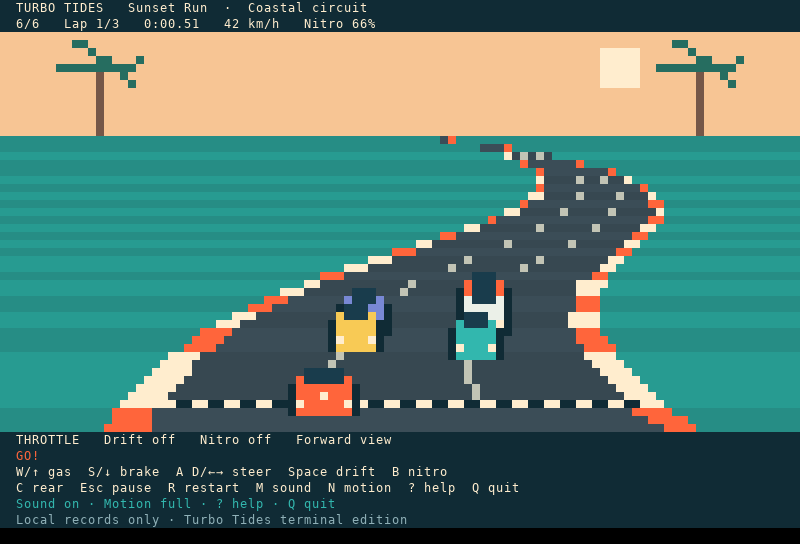
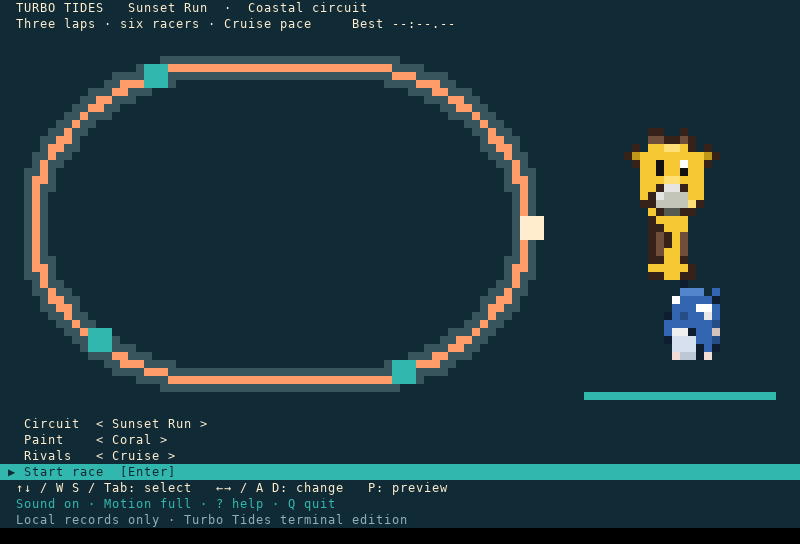

# Turbo Tides TUI


**A colorful coastal arcade racer, running entirely in your terminal.**
Race Phippy, Goldie, Hazel, Kube, and Zee through six circuits. Find the racing
line, charge nitro with a drift, catch a mint turbo strip, and chase a three-lap
personal best.

This is the terminal edition of [Turbo Tides](https://github.com/samsaw123456/turbo-tides),
built with Kotlin, JVM 25, and [tui4j](https://github.com/WilliamAGH/tui4j).
It keeps the original race simulation and track geometry, and reuses the
[Phippy Gaming Workshop](https://github.com/Tingsters/Phippy-Gaming-Workshop)
characters, Turbo Tides icon, paint palette, and sound assets.



## Install and race

On Linux or macOS:

```sh
curl -fsSL https://raw.githubusercontent.com/samsaw123456/turbotides-tui/main/install.sh -o /tmp/turbotides-install.sh
sh /tmp/turbotides-install.sh
~/.local/bin/turbotides-tui
```

The installer checks dependencies, verifies the release checksum, finds Java 25
or installs a private Temurin runtime, and adds an application launcher with the
original icon. It needs no administrator password and leaves system Java alone.
Use `sh /tmp/turbotides-install.sh --private-java` to always install the latest
Temurin 25 patch in a private runtime. Linux gets an application-menu entry; macOS gets `~/Applications/Turbo Tides TUI.app`
for Terminal.app and your Dock. [Installation, updates, and removal](docs/INSTALLATION.md).

Use a UTF-8 terminal with true color; **100 × 34 or larger** is comfortable.
The minimum is 64 × 24. Apple Terminal uses a 256-color fallback;
set `TURBOTIDES_COLOR=truecolor` on macOS Tahoe 26 or newer for full color,
or `TURBOTIDES_COLOR=256` to force indexed color in any terminal. Letter bindings are unshifted keys. Resize smaller and the race pauses. Everything works
offline after installation. No accounts, ads, uploads, or game telemetry service.

## Pick your circuit



| Circuit | Setting |
| --- | --- |
| Sunset Run | Palm trees, ocean bends, warm coastal light |
| Cinder Ring | Red-rock climbs and tightening corners |
| San Francisco — Golden Gate Run | Orange suspension bridge and city hills |
| Silicon Valley — Campus Sprint | Solar roofs and sweeping campus bends |
| New York City — Midtown Mile | Four blocks, park, and skyline |
| Chicago — Lakeshore Loop | Lakefront and twin-antenna skyline |

In the garage, use **Up/Down, W/S, Tab, or Shift+Tab** to select a row.
**Left/Right or A/D** changes it. Enter activates it. With Start selected,
Left/Right still browses circuits and **Enter races**. P switches between the
actual circuit map and the starting grid. Five paint colors and two rival paces
(Cruise and Race) are available. Personal bests are separate for each circuit
and pace.

## Drive

| Key | Effect |
| --- | --- |
| W / Up | Turn throttle on; it stays on |
| S / Down | Turn brake on and throttle/nitro off; W resumes |
| A / Left | Nudge left; keyboard repeat sustains steering |
| D / Right | Nudge right; keyboard repeat sustains steering |
| Space | Toggle drift mode; steer at speed to charge nitro |
| B | Toggle nitro mode; needs throttle, charge, and road |
| C | Toggle rear view; forward-relative steering appears mirrored |
| Esc | Pause/resume; return to garage after finishing |
| R | Restart from countdown, racing, pause, or results |
| Enter | Resume when paused; retry after finishing |
| G | Return to garage when paused or finished |
| M | Mute/unmute original music, engine, and effects |
| N | Toggle reduced car motion and boost effects |
| ? | Open/close controls; pauses an active race |
| Q / Ctrl+C | Quit cleanly |

Ordinary ANSI terminals send key presses, **not key releases or standalone
Shift**. Throttle/brake and drift/nitro/rear-view are explicit modes shown below
the road. Tap the mode keys; do not hold them. Fast autorepeats are suppressed,
but the first delayed OS repeat can count as another tap. Steering expires
180 ms after the last key event, so a released key cannot stay stuck; the OS's
initial repeat delay is perceptible. Opposing steering presses use the most
recent direction. Tap Esc and wait for the pause screen: tightly packed Escape
bytes can be decoded as Alt+Esc and ignored by the input library. This portable
control scheme works without Kitty keyboard,
mouse capture, terminal image extensions, or a patched terminal.

Steer while drifting above 22 m/s for at least 0.45 seconds; ending the drift
or stopping steering banks the charge. Mint strips give turbo once per lap.
Grass slows you down, barriers bounce you back, and rival contact costs speed.
There is no reverse, jump, death, or elimination: a slower finish still counts.
Focus loss clears driving modes and pauses **when the terminal reports focus**.
Pause manually before switching away in terminals without focus reporting.
Resuming always clears driving modes; press W to accelerate again.

## What carries over

The same distance-sampled tracks and fixed 120 Hz rules drive acceleration,
braking, lateral inertia, corner forces, collision recovery, AI, nitro, drift
banking, lap timing, and finish order. The terminal uses a colorful half-block
perspective view, schematic skylines, and the actual track map. It does not
recreate libGDX's full 3D models, vertical camera, lighting, or font rendering.
Your terminal chooses the font. Fullscreen belongs to your terminal; F11,
standalone Shift, controllers, touch, and mouse menus are not game bindings.

Audio uses the original WAVs through Java Sound ([device-output audit](docs/AUDIO.md)). A missing audio device is
reported in the footer and does not prevent racing. Settings and records live
in the per-user data directory. `--data-dir DIR` gives an isolated profile;
`--telemetry FILE` enables local diagnostic JSON for playtests and changes no
rules. `--help` lists command-line options.

## Build, verify, contribute

```sh
./turbotides-tui                  # discover JDK 25, build, then play
./gradlew check fatJar            # lint, compile, regression tests, executable JAR
./gradlew ktlintFormat            # format Kotlin
./install.sh --local              # build and install this checkout
python3 tools/package_release.py --skip-build
```

The wrapper pins Gradle **9.9.1** with its distribution checksum. Kotlin
**2.4.21**, tui4j **0.3.5**, and the ktlint plugin **14.2.0** are pinned to
published stable releases checked on November 14, 2026. The JVM target is **25**.
Set `JAVA_HOME` to JDK 25 for direct Gradle commands. The launcher and installer
discover Java independently; Gradle is downloaded by the wrapper.

The [verification record](docs/VERIFICATION.md) inventories every binding and
state, records real PTY/ANSI playtests, and lists platform limits. Tests never
accelerate races or mutate the running simulation. To reproduce the terminal
audit, install `tools/audit-requirements.txt` in a virtual environment and run
`python tools/ansi_audit.py --help`. [Design decisions](docs/DESIGN.md) describe
what changed for the medium.

Code and original assets: Apache-2.0. Phippy/Goldie and library notices are in
[THIRD_PARTY.md](THIRD_PARTY.md). This independent game is not endorsed by CNCF
or the Linux Foundation.
