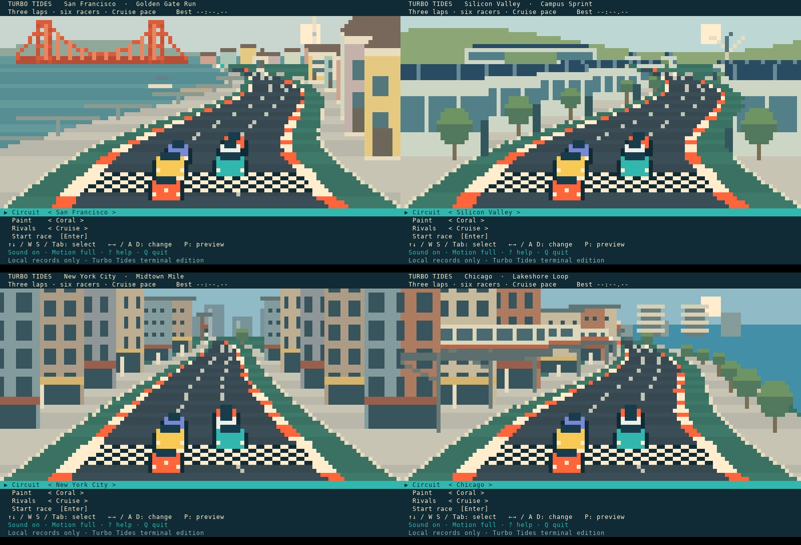

# City environments

Version 0.1.2 gives the four city circuits street-level architecture adapted
from the original game's procedural artwork. It keeps the existing race rules,
course geometry, lap records and controls.

- **San Francisco:** an open bayfront with piers and boats reveals the orange
  suspension bridge. The course then passes pastel houses with peaked roofs,
  cream trim and projecting bay windows. Hills and a narrow Pyramid silhouette
  sit behind the neighborhood.
- **Silicon Valley:** low glass-fronted campus buildings, solar roofs, street
  trees, foothills and a communications dish.
- **New York:** taller masonry blocks with repeated floors, shopfront awnings,
  stepped skyline towers and stretches of park trees.
- **Chicago:** brick frontage and elevated cream-and-teal trains on one side,
  an open lakefront on the other, with antenna and balcony-banded towers behind.



Buildings are anchored to distance around the actual course and scale as they
approach. Their placement reverses with the labelled rear camera. Sidewalks and
facades stay outside the physical barrier; the grass shoulder still communicates
the original slowdown and recovery rules. Road markings, turbo pads and cars
are drawn above scenery so a facade cannot hide a driving hazard.

These are recognizable, stylized environments at terminal pixel resolution.
They are not exact city street maps, and the skyline hills do not add a new
vertical road projection. The source game's newer route changes are not copied
into this scenery update; existing TUI course lengths and records remain valid.

## Reproduce the visual playtest

With JDK 25 and the audit Python environment from [VERIFICATION.md](VERIFICATION.md):

```sh
./gradlew ktlintFormat check fatJar
python tools/city_audit.py
python tools/city_audit.py --previews-only --size 64x24
python tools/city_audit.py --previews-only --size 180x65
TURBOTIDES_COLOR=256 python tools/city_audit.py --previews-only
```

The city audit uses a real PTY, ordinary key presses, isolated records and normal
simulation timing. It captures the starting-grid preview, four points around
each course, rear view, pause/resume, a three-lap finish and retry. Screenshots
are decoded from the application's ANSI output. Read-only diagnostics help the
repeatable driver choose steering keys; the independent manual playtest and
complete control audit remain separate checks.
